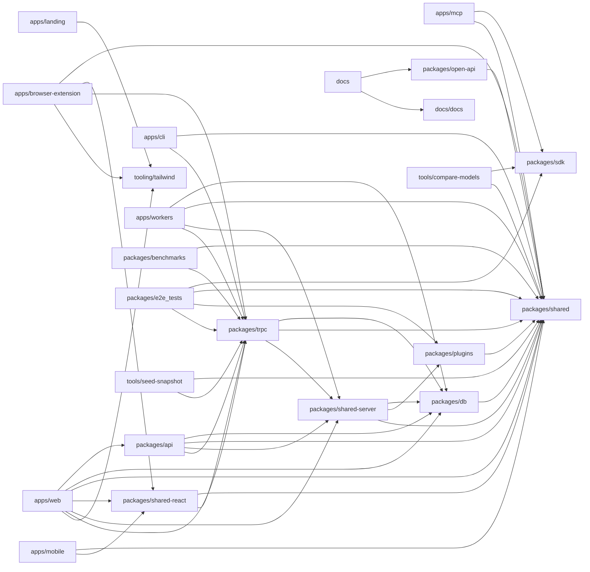

# Architecture

Karakeep is a pnpm/Turbo-style TypeScript monorepo for a self-hostable 'bookmark everything' platform. The domain core lives in packages/shared (Zod schemas, config, search-query parser, LLM/embedding client factories, prompt builders) and packages/trpc (domain models, repos/services, tRPC routers, auth, rate-limiting, rule engine, hybrid search ranking). packages/db wraps SQLite/Drizzle; packages/shared-server adds queues, asset storage, quotas and OpenTelemetry; packages/plugins supplies swappable backends (filesystem/S3 asset stores, Liteque/Restate queues, Meilisearch search + vector store, memory/Redis rate limiters). packages/api exposes the Hono REST + tRPC HTTP surface, documented by packages/open-api and consumed through the generated packages/sdk. Clients share packages/shared-react (tRPC/React Query hooks, highlighter, reading-progress) and tooling/tailwind: apps/web (Next.js dashboard, reader, admin, settings, better-auth), apps/mobile (Expo/React Native with offline library and MMKV cache), apps/browser-extension (Chrome/Firefox popup with SingleFile capture), apps/cli (Commander), and apps/mcp (Model Context Protocol server for LLM agents). apps/workers runs the asynchronous pipeline: Patchright crawling (local or remote), metadata/reader extraction, OCR/PDF preprocessing, AI tagging and summarization via OpenAIQueue, embeddings via EmbeddingsQueue, search indexing, feeds, imports, rules, webhooks, backups and maintenance. AI is a first-class concern end to end: user-configurable auto-tagging/summarization and custom prompts, 'ai' vs 'human' tag attribution surfaced in every client, FTS/semantic/hybrid search modes, and dedicated tooling (tools/compare-models, agent skills, MCP). Supporting packages cover e2e/Docker tests, benchmarks, seed snapshots, landing site (Astro) and Docusaurus docs.

## Modules

| module | summary | AI |
| --- | --- | --- |
| `.agents/skills` | Agent-oriented CLI (i18n.mjs) that audits and applies translation keys across web/mobile locales using git history. | — |
| `apps/browser-extension` | Chrome/Firefox extension popup and background worker for saving pages, SingleFile capture, and editing tags/lists/notes via tRPC. | — |
| `apps/cli` | Commander-based CLI for bookmarks, lists, tags, admin, dump/migrate/wipe, and exporting the agent SKILL.md. | [AI] |
| `apps/landing` | Astro + React marketing site with pricing data, app directory, legal pages and a /pricing.md API route. | [AI] |
| `apps/mcp` | Model Context Protocol stdio server exposing bookmark, list, tag, highlight and asset tools to LLM clients via the SDK. | — |
| `apps/mobile` | Expo/React Native client with offline library, MMKV query persistence, reader, highlights, search modes and AI summaries. | — |
| `apps/web` | Next.js dashboard, reader, admin, settings, public lists, better-auth, and route handlers mounting the Hono API. | [AI] |
| `apps/workers` | Background queue workers: crawling (local/remote Patchright), asset preprocessing, AI tagging/summaries, embeddings, search indexing, feeds, imports, rules, webhooks, backups. | [AI] |
| `docs` | Docusaurus site configuration with OpenAPI docs generation and Algolia search. | — |
| `docs/docs` | API sidebar navigation config for the current docs version. | — |
| `docs/src` | Custom Docusaurus theme components (sidebar categories with Lucide icons). | — |
| `docs/versioned_docs` | Historical API sidebar configs for released doc versions v0.28–v0.34. | — |
| `packages/api` | Hono HTTP app: REST /v1 routes, tRPC adapter, auth/scope/rate-limit/read-only middlewares, asset streaming, billing webhooks, metrics. | — |
| `packages/benchmarks` | Tinybench load-testing suite that boots a Docker stack, seeds data via tRPC and measures query latency. | — |
| `packages/db` | better-sqlite3 + Drizzle ORM schema, connection pragmas, OpenTelemetry instrumentation and migrations. | — |
| `packages/e2e_tests` | Vitest/Playwright E2E suite running Docker containers to validate API, UI, workers (crawl, inference, embeddings) and storage plugins. | — |
| `packages/open-api` | Generates and validates the OpenAPI 3.0 spec from Zod schemas and route registries. | — |
| `packages/plugins` | Pluggable backends: filesystem/S3 asset stores, Liteque/Restate queues, memory/Redis rate limiters, Meilisearch search and vector store. | — |
| `packages/sdk` | Typed openapi-fetch client (createKarakeepClient) generated from the OpenAPI schema. | — |
| `packages/shared` | Cross-cutting Zod types, config validation, prompt builders, OpenAI/Ollama inference clients, search query parser, import/export, plugin interfaces. | [AI] |
| `packages/shared-react` | Shared React hooks/components: tRPC + React Query provider, bookmark/list/tag mutations, highlighter, reading progress, reader settings. | — |
| `packages/shared-server` | Server utilities: queue definitions (OpenAIQueue, EmbeddingsQueue, crawler queues), asset DB, quotas, plugin loading, tracing and event logging. | [AI] |
| `packages/trpc` | Backend business logic: domain models, repos/services, tRPC routers, auth, rule engine, SQL search builder, RRF hybrid ranking, subscriptions. | [AI] |
| `tooling/tailwind` | Shared Tailwind presets for web and NativeWind. | — |
| `tools/compare-models` | Interactive blind A/B CLI comparing LLM auto-tagging quality between models or against existing AI tags. | [AI] |
| `tools/seed-snapshot` | CLI to generate and apply deterministic seed-data snapshot archives for dev and migration testing. | — |

## Module dependencies

_`[AI]` marks modules with AI/LLM touchpoints (prompt files, model API calls, agent logic)._
